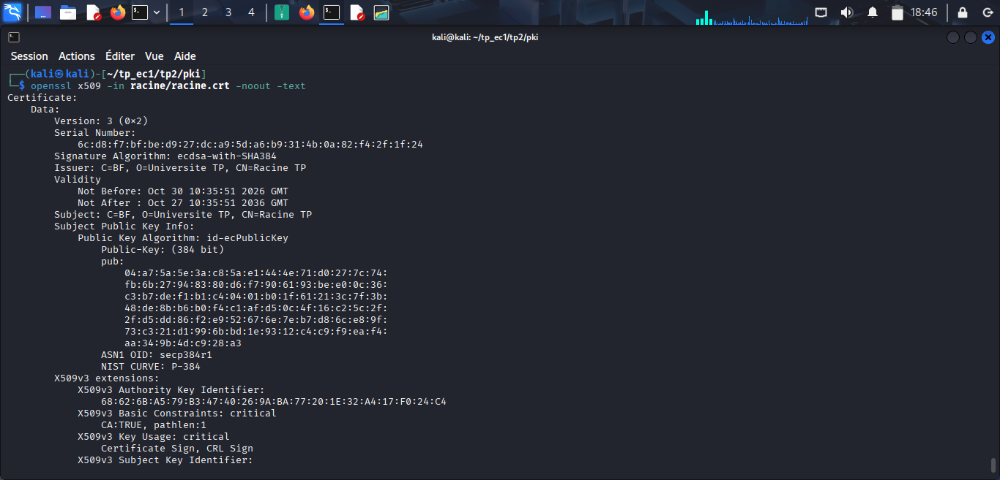

# tp_ec1
Travaux Dirigés sur l'ingénierie de la cryptographie, Cryptologie, clés et certificat
# EC1 – Ingénierie de la cryptographie : comptes rendus des TP

Nom et Prénoms: PARE Salimata Nadège

Ce README tient lieu de compte rendu pour les trois TP. Le code, les scripts, les configurations, les certificats publics et les captures se trouvent dans les dossiers `tp1/`, `tp2/pki/` et `tp3/`. Aucune clé privée n'est versionnée : les fichiers `*.key` sont exclus par le `.gitignore`.

---

## TP 1 – Chiffrement authentifié et dérivation de clés

Code : tp1/coffre.py 
Tests: tp1/test_coffre.py

### Étape 1 – Mesure du temps de dérivation

Avec les paramètres de départ (T = 3 passes, M = 64 Mio, P = 4), cinq mesures de `cle_maitresse` ont donné entre 0,11 et 0,13 s, soit environ quatre fois moins que l'objectif de 0,5 s. Le temps d'Argon2id étant à peu près proportionnel à T, j'ai estimé qu'une passe coûte environ 0,04 s et choisi T = 12 (0,5 / 0,04). Quatre nouvelles mesures ont donné 0,46 s, 0,46 s, 0,53 s et 0,54 s, ce qui correspond à l'objectif. Les paramètres retenus sont donc **T = 12, M = 64 Mio et P = 4**. J'ai ajusté T plutôt que M pour ne pas augmenter la mémoire consommée.

### Étape 2 – Format du fichier chiffré

Le fichier commence par un en-tête de 44 octets : l'identifiant `CFR1` (4 octets), les paramètres T, M et P (12 octets), le sel (16 octets) et le nonce (12 octets). Viennent ensuite le texte chiffré et l'étiquette d'authentification de 16 octets ajoutée par AES-GCM. L'en-tête et le nom du fichier sont passés comme données associées : ils sont authentifiés sans être chiffrés.

### Étape 3 – Tests de sécurité

Les cinq tests écrits avec pytest passent (`5 passed`) ; chacun vérifie une propriété précise.

- `test_aller_retour` chiffre puis déchiffre et vérifie qu'on retrouve exactement les données d'origine : c'est la propriété de correction.
- `test_deux_chiffrements_differents` chiffre deux fois le même fichier avec le même mot de passe et vérifie que les deux résultats diffèrent, ainsi que leurs sels et leurs nonces : c'est le chiffrement probabiliste, obtenu grâce au sel et au nonce neufs tirés à chaque appel.
- `test_mauvais_mot_de_passe` déchiffre avec un autre mot de passe et attend `InvalidTag` : la clé dérivée est différente, donc l'étiquette ne correspond plus, ce qui authentifie la clé.
- `test_octet_modifie` inverse un seul bit du texte chiffré et attend `InvalidTag` : c'est la propriété d'intégrité.
- `test_nom_echange` déchiffre avec un autre nom de fichier et attend `InvalidTag` : le chiffré est lié à son contexte par les données associées.

### Étape 4 – Évolution des paramètres

Le format permet de durcir les paramètres Argon2id parce que chaque fichier porte dans son en-tête les valeurs de T, M et P utilisées pour le chiffrer, et que `dechiffrer` les relit dans le fichier au lieu d'utiliser les constantes du module. On peut donc augmenter T ou M pour les nouveaux fichiers sans rendre illisibles les anciens, qui se déchiffrent avec leurs propres paramètres. L'identifiant `CFR1` joue le même rôle pour la structure : un format futur s'appellerait `CFR2`.

La fonction `rechiffrer` déchiffre le fichier avec l'ancien mot de passe puis le chiffre de nouveau avec le nouveau :

```python
def rechiffrer(ancien_mdp, nouveau_mdp, nom, blob):
    donnees = dechiffrer(ancien_mdp, nom, blob)
    return chiffrer(nouveau_mdp, nom, donnees)
```

Si l'ancien mot de passe est faux, `InvalidTag` est levée avant tout rechiffrement. Le fichier produit a un sel, un nonce et des paramètres neufs : `rechiffrer` change donc le mot de passe et fait aussi migrer le fichier vers les paramètres actuels.

### Questions de réflexion

**1. Pourquoi le sel est-il stocké en clair ? Sa publication affaiblit-elle la sécurité ?**
Le sel n'est pas un secret. Son rôle est de rendre la dérivation unique pour chaque fichier, ce qui empêche les tables précalculées et fait que deux fichiers protégés par le même mot de passe n'ont pas la même clé. Il doit être stocké pour permettre de redériver la clé. Le connaître n'affaiblit pas la sécurité : l'attaquant doit toujours deviner le mot de passe, en payant le coût d'Argon2id pour chaque essai et pour chaque fichier.

**2. Pourquoi n'y a-t-il aucun risque de répétition du nonce, même pour des millions de fichiers ?**
Ce qui est interdit avec AES-GCM, c'est de réutiliser le même nonce avec la même clé. Ici le sel est neuf pour chaque fichier, donc la clé change à chaque fichier et chaque clé ne chiffre qu'un seul message. Que deux fichiers aient par hasard le même nonce est sans conséquence, puisque leurs clés sont différentes.

**3. Que se passerait-il si le nom du fichier n'était pas dans les données associées ?**
Le chiffré ne serait pas lié à son nom. Un attaquant qui a accès au stockage pourrait, par exemple, échanger `facture_payee.enc` et `facture_a_payer.enc`, chiffrés avec le même mot de passe. Chaque fichier se déchiffrerait correctement sans aucune erreur, et l'utilisateur lirait un contenu authentique mais au mauvais endroit. Avec le nom dans les données associées, l'échange provoque `InvalidTag`.

**4. Pourquoi l'en-tête lui-même est-il authentifié ? Que pourrait faire un attaquant sinon avec les paramètres Argon2id ?**
L'authentification de l'en-tête garantit que toute modification d'un de ses champs (identifiant, paramètres, sel, nonce) est détectée. Sans elle, un attaquant pourrait altérer les paramètres Argon2id, par exemple les réduire pour une attaque par rétrogradation, ou les gonfler pour épuiser la mémoire de la machine, puisque la dérivation est calculée avant la vérification de l'étiquette. Dans notre format, des paramètres modifiés changent déjà la clé redérivée et font échouer le déchiffrement, mais l'authentification rend ce rejet explicite. Une implémentation réelle plafonnerait en plus les valeurs de T et de M lues dans le fichier.

**5. Pourquoi ne doit-on jamais afficher à l'utilisateur la raison précise d'un échec de déchiffrement ?**
Distinguer « mauvais mot de passe », « fichier modifié » et « mauvais nom » donnerait à un attaquant un oracle : il apprendrait ce qui est correct et pourrait procéder par essais successifs. On affiche donc un message unique du type « déchiffrement impossible », et le détail éventuel reste dans un journal interne.

---

## TP 2 – Infrastructure de gestion de clés

Fichiers: racine.cnf, inter.cnf et pki.sh dans `tp2/pki/`.

### Étape 1 – Rôle de chaque ligne des sections d'extensions

Une extension marquée `critical` doit être comprise par le logiciel qui vérifie le certificat ; s'il ne la connaît pas, il rejette le certificat.

**Section `ext_inter`** (certificat de l'AC intermédiaire). 
`basicConstraints = critical,CA:TRUE,pathlen:0` déclare que le certificat est celui d'une autorité, qui a donc le droit de signer, mais `pathlen:0` lui interdit de signer une autre AC : elle ne peut émettre que des certificats finaux. 
`keyUsage = critical,keyCertSign,cRLSign` limite l'usage de la clé à la signature de certificats et de listes de révocation. 
`nameConstraints = critical,permitted;DNS:.tp.local,permitted;DNS:tp.local,permitted;email:tp.local` restreint les noms que l'intermédiaire peut certifier : les sous-domaines de `tp.local`, `tp.local` lui-même et les adresses e-mail de ce domaine. 
`subjectKeyIdentifier = hash` donne au certificat un identifiant calculé à partir de sa clé publique, et `authorityKeyIdentifier = keyid` y ajoute l'identifiant de la clé de l'émetteur (la racine), ce qui aide à reconstituer la chaîne.

**Section `ext_serveur`** (certificat du serveur). 
`basicConstraints = critical,CA:FALSE` indique que le certificat est final et ne peut signer aucun autre certificat. 
`keyUsage = critical,digitalSignature` limite la clé à la signature, ce qui correspond à la poignée de main TLS. `extendedKeyUsage = serverAuth` précise que le certificat sert à authentifier un serveur TLS, et non un client. 
`subjectKeyIdentifier` et `authorityKeyIdentifier` ont le même rôle que ci-dessus. 
Les noms alternatifs (SAN) ne figurent pas dans cette section : ils viennent de la demande de certificat, que `copy_extensions = copy` recopie dans le certificat signé.

**Section `ext_client`** (certificat du client). Elle reprend les mêmes lignes que le serveur, avec deux différences : `extendedKeyUsage = clientAuth` indique que le certificat sert à authentifier un client TLS, et `subjectAltName = email:alice@tp.local` inscrit l'identité du client, écrite directement dans la configuration. Pour le TP 3, j'ai ajouté une section `ext_client_bob` identique avec l'adresse de Bob, afin que son certificat ne porte pas celle d'Alice.

### Étape 2 – Certificat de l'AC racine

La sortie de `openssl x509 -in racine/racine.crt -noout -text` donne : émetteur et sujet identiques (`C=BF, O=Universite TP, CN=Racine TP`), validité du 30 octobre 2026 au 27 octobre 2036 (dix ans), clé à courbe elliptique de 384 bits (`secp384r1`, soit P-384), signature `ecdsa-with-SHA384`, et deux extensions critiques : `Basic Constraints: CA:TRUE, pathlen:1` et `Key Usage: Certificate Sign, CRL Sign`.



**Pourquoi l'émetteur et le sujet sont-ils identiques ?** Parce que le certificat est auto-signé : la racine se certifie elle-même, car aucune autorité ne se trouve au-dessus d'elle. C'est une ancre de confiance, que l'on reçoit par un canal sûr et sur laquelle s'appuie toute la chaîne.

### Étape 3 – Certificat de l'AC intermédiaire

Après signature par la racine, le certificat de l'intermédiaire contient bien `Basic Constraints: critical, CA:TRUE, pathlen:0`, `Key Usage: critical, Certificate Sign, CRL Sign` et une extension `Name Constraints` critique limitant les noms permis à `tp.local`. La commande `openssl verify -CAfile racine/racine.crt inter/inter.crt` confirme que la racine a bien signé ce certificat.


### Étape 5 – Validation des certificats

La chaîne du serveur est acceptée (`OK`) pour le nom `www.tp.local` : les signatures, les dates, les contraintes de nom et le nom d'hôte sont corrects. Avec le nom `autre.example`, la validation échoue : la chaîne est bonne, mais le certificat n'a pas été émis pour ce nom. Le certificat d'Alice est accepté avec l'usage `sslclient`, ce qui confirme son `extendedKeyUsage = clientAuth`. Enfin, le certificat demandé pour `www.example.com` est refusé avec l'erreur `permitted subtree violation`, parce que ce nom sort de la zone `tp.local` autorisée par l'intermédiaire.


**Pourquoi l'AC a-t-elle pu signer ce certificat alors qu'il est refusé à la validation ?** L'outil `openssl ca` se contente de signer ce qu'on lui présente : il n'applique pas les contraintes de nom de son propre certificat. Ces contraintes sont inscrites dans le certificat de l'intermédiaire et sont appliquées par le vérificateur (navigateur, `openssl verify`, nginx) lorsqu'il parcourt la chaîne. Leur intérêt est de ne pas dépendre de la bonne conduite de l'intermédiaire : même compromise ou mal configurée, elle ne peut pas faire accepter un certificat en dehors de `tp.local`.

### Étape 6 – Révocation

Après `openssl ca -revoke alice.crt -crl_reason keyCompromise`, la sortie indique `Revoking Certificate 2001. Database updated`. La CRL de l'intermédiaire, publiée le 30 octobre 2026 à 12:06:46 GMT et valable jusqu'au 6 novembre (sept jours), liste le numéro de série 2001 avec la raison `Key Compromise`. Son numéro de CRL s'affiche 8192, ce qui correspond à `2000` en hexadécimal, la valeur de départ du fichier `crlnumber`. La vérification avec `-crl_check_all` donne bien `error 23 at 0 depth lookup: certificate revoked`.

Sans les CRL, la même vérification renvoie `OK` : la révocation n'est contrôlée que si on fournit les listes. L'option `-crl_check_all` contrôle toute la chaîne, d'où la nécessité d'une CRL pour chaque autorité, y compris celle de la racine, qui est vide.

### Étape 7 – Script `pki.sh`

Le script regroupe la création de la racine, de l'intermédiaire, du serveur et du client. Il commence par `set -euo pipefail` : il s'arrête dès qu'une commande échoue (`-e`), traite une variable non définie comme une erreur (`-u`) et considère qu'un tube échoue si l'une de ses commandes échoue (`pipefail`). Comme il ne protège rien et écraserait clés et compteurs, il doit être lancé dans un dossier vide contenant seulement `racine.cnf` et `inter.cnf`.

### Questions de réflexion

**1. Pourquoi la clé de la racine doit-elle rester hors ligne ? Que faire si l'intermédiaire est compromise ? Et la racine ?**
La racine est l'ancre de confiance : avec sa clé, on peut émettre un certificat accepté par tous les clients, et on ne peut pas la révoquer comme une autre autorité. On la garde donc hors ligne, allumée seulement pour signer l'intermédiaire ou ses propres CRL. Si l'intermédiaire est compromise, la racine la révoque dans sa CRL, on crée une nouvelle intermédiaire avec une nouvelle clé, on réémet les certificats finaux et on publie de nouvelles CRL ; les contraintes de nom limitent les dégâts. Si la racine est compromise, toute la hiérarchie est perdue : il faut créer une nouvelle racine et une nouvelle PKI, redistribuer la nouvelle ancre à tous les clients, retirer l'ancienne de leurs magasins de confiance et informer les utilisateurs.

**2. À quoi sert `pathlen:0` sur l'intermédiaire ? Quel risque si on l'oublie ?**
Il interdit à l'intermédiaire de signer une autre AC : elle ne peut émettre que des certificats finaux. Si on l'oublie, quiconque détient sa clé pourrait créer une autorité subordonnée qui émet à son tour des certificats, hors du contrôle de la racine et difficile à recenser ou à révoquer. Un certificat d'AC signé par l'intermédiaire est refusé à la validation (`path length constraint exceeded`).

**3. Pourquoi la clé privée du serveur est-elle générée par le serveur et non par l'AC ?**
Une clé privée ne doit jamais circuler ni être connue d'un tiers. L'AC certifie une clé publique, et la demande de certificat, signée avec la clé privée, prouve que le demandeur la possède. Si l'AC générait la clé, elle devrait la transmettre, avec un risque d'interception, et elle la connaîtrait : une AC compromise exposerait alors toutes les clés.

**4. Le CN et le SAN contiennent tous deux `www.tp.local`. Lequel les clients modernes vérifient-ils ?**
Ils vérifient le SAN. Le CN n'est plus utilisé pour valider un nom d'hôte, et un certificat sans SAN est refusé ; c'est pourquoi les noms alternatifs sont placés dans la demande de certificat.

**5. Quelles sont les limites des CRL ? Comparer avec OCSP et avec des certificats de très courte durée.**
Une CRL est une liste qui grossit et qu'il faut télécharger en entier. Entre la révocation et la publication de la CRL suivante, le certificat révoqué reste accepté. Certains clients ne la consultent pas ou continuent si elle est inaccessible, et une CRL périmée peut bloquer tout le monde, comme nginx qui refuse alors tous les clients. OCSP permet d'interroger l'état d'un seul certificat en quasi temps réel, avec de petites réponses, mais le répondeur doit être disponible, il apprend quels sites sont visités et il ajoute de la latence ; l'agrafage OCSP atténue ces défauts. Des certificats de très courte durée rendent la révocation presque inutile, puisque l'expiration arrive vite et limite l'exposition d'une clé volée, mais ils exigent d'automatiser le renouvellement (voir TP 3).

**6. Politique de certification minimale.**

1. L'AC racine est hors ligne ; elle ne signe que l'intermédiaire et ses propres CRL.
2. L'AC intermédiaire signe les certificats finaux, uniquement pour les noms de `tp.local`.
3. Un certificat de serveur peut être demandé par l'administrateur du nom concerné ; un certificat de client, par un utilisateur de l'université.
4. L'identité du demandeur est vérifiée avant toute signature (administrateur connu de l'opérateur de l'AC, ou compte institutionnel confirmé en personne).
5. Chaque titulaire génère sa propre clé privée et ne transmet que la demande de certificat.
6. Les certificats finaux durent 90 jours, l'intermédiaire 5 ans et la racine 10 ans.
7. Les clés privées ne sont jamais envoyées par courriel ni placées dans un dépôt de code.
8. Le titulaire signale toute perte ou compromission de sa clé sous 24 heures.
9. L'AC révoque alors le certificat (raison `keyCompromise`) et republie sa CRL au plus vite ; les CRL ont une validité de 7 jours.
10. Les émissions et les révocations sont journalisées dans le registre de l'AC, et les certificats publics sont consultables.

---

## TP 3 – Canal sécurisé et gestion des certificats

Ce TP réutilise la PKI du TP 2. Livrables : tp3/nginx/tp.local.conf, tp3/surveiller.py, tp3/renouveler.sh et les captures de `tp3/captures/`.

### Étape 2 – Justification des directives nginx

```nginx
server {
    listen 443 ssl;
    server_name www.tp.local;

    ssl_certificate     /etc/nginx/tls/serveur_chaine.crt;
    ssl_certificate_key /etc/nginx/tls/serveur.key;
    ssl_protocols TLSv1.2 TLSv1.3;
    ssl_prefer_server_ciphers off;
    ssl_session_tickets off;

    ssl_client_certificate /etc/nginx/tls/racine.crt;
    ssl_verify_client on;
    ssl_verify_depth 2;
    ssl_crl /etc/nginx/tls/crls.pem;

    add_header Strict-Transport-Security "max-age=31536000" always;

    location / { return 200 "Bonjour $ssl_client_s_dn\n"; }
}
```

`listen 443 ssl` fait écouter nginx sur le port HTTPS avec TLS activé, et `server_name www.tp.local` associe ce bloc au nom du certificat. `ssl_certificate` désigne le certificat du serveur suivi de celui de l'intermédiaire, sans la racine, pour que le client puisse reconstituer la chaîne ; `ssl_certificate_key` désigne la clé privée correspondante, protégée par des droits `600` car quiconque la lit peut se faire passer pour le serveur. `ssl_protocols TLSv1.2 TLSv1.3` n'accepte que les versions sûres et exclut SSL 3, TLS 1.0 et TLS 1.1, obsolètes. `ssl_prefer_server_ciphers off` laisse le client choisir parmi des suites toutes jugées sûres, et `ssl_session_tickets off` évite qu'une clé de ticket non renouvelée permette de déchiffrer des sessions enregistrées (question 2).

Pour l'authentification mutuelle, `ssl_client_certificate` indique l'autorité à laquelle on fait confiance pour les certificats clients, ici la racine ; `ssl_verify_client on` exige un certificat client valide ; `ssl_verify_depth 2` accepte une chaîne de deux niveaux (client, intermédiaire, racine) ; `ssl_crl` fournit les listes de révocation, une par autorité de la chaîne, d'où le fichier `crls.pem` qui rassemble celle de l'intermédiaire et celle de la racine. L'en-tête `Strict-Transport-Security` impose HTTPS au navigateur pendant un an, et `always` l'envoie aussi sur les réponses d'erreur (question 3). Enfin, `return 200 "Bonjour $ssl_client_s_dn"` renvoie le nom du certificat du client, ce qui prouve que l'authentification a eu lieu.

### Étape 3 – Observation de la poignée de main

Pour le test avec un client valide, j'ai émis un certificat pour Bob, car la section `ext_client` contient l'adresse d'Alice en dur. Avec `openssl s_client` et ce certificat, j'ai relevé : version **TLS 1.3**, suite de chiffrement **`TLS_AES_256_GCM_SHA384`**, groupe d'échange de clés **`X25519MLKEM768`** (un échange hybride qui combine la courbe X25519 et le mécanisme post-quantique ML-KEM-768), et résultat de la vérification **`Verification: OK`**, le certificat du serveur étant validé avec la chaîne et le nom `www.tp.local`. L'option `-cert_chain` est nécessaire pour envoyer aussi l'intermédiaire, car le serveur ne connaît que la racine.

**Avec le certificat révoqué d'Alice**, la connexion est refusée. Le serveur lit la liste de révocation fournie par `ssl_crl`, y trouve le numéro de série d'Alice et rejette son certificat avec l'erreur `certificate revoked` (code 23), visible dans le journal de nginx. En TLS 1.3, le client considère la poignée de main comme terminée dès qu'il a envoyé son certificat, et c'est seulement ensuite que le serveur le contrôle ; le refus n'apparaît donc pas dans la sortie de `s_client`, mais dans la réponse de `curl` et dans le journal du serveur.

**Capture Wireshark.** Sur l'interface `lo`, avec le filtre `tls.handshake.type == 1 || tls.handshake.type == 2`, on identifie le `ClientHello`, par lequel le client propose ses versions de TLS, ses suites de chiffrement et sa part d'échange de clés (extension `key_share`), puis le `ServerHello`, par lequel le serveur choisit la version et la suite et renvoie sa part d'échange de clés.
Les captures d'écrans se trouve dans `tp3/captures/`.

**Pourquoi le certificat du serveur n'est-il pas visible en TLS 1.3 ?** Dès le `ServerHello`, le client et le serveur ont calculé un secret partagé grâce à l'échange de clés, et tout le reste de la poignée de main, dont le message `Certificate`, est envoyé chiffré. En TLS 1.2, ce message circule en clair. Un observateur du réseau ne voit donc plus, en TLS 1.3, l'identité du serveur ni celle du client.

### Étape 4 – Vérification de la configuration

La commande `nmap --script ssl-enum-ciphers` ne liste que TLS 1.2 et TLS 1.3 : TLS 1.1 est donc bien refusé. Avec la configuration de l'étape 2, elle liste treize suites en TLS 1.2, toutes avec échange de clés éphémère (`ECDHE`), donc avec confidentialité persistante, mais dont six utilisent le mode CBC, qui n'est pas un chiffrement authentifié (`AES_128_CBC_SHA`, `AES_128_CBC_SHA256`, `AES_256_CBC_SHA`, `AES_256_CBC_SHA384`, `CAMELLIA_128_CBC_SHA256` et `CAMELLIA_256_CBC_SHA384`). Bien que nmap leur attribue la note A, l'énoncé demande de corriger toute suite sans chiffrement authentifié. J'ai donc ajouté à la configuration la directive suivante, qui ne garde que des suites `ECDHE` avec AES-GCM ou ChaCha20-Poly1305 :

```nginx
ssl_ciphers ECDHE-ECDSA-AES256-GCM-SHA384:ECDHE-ECDSA-AES128-GCM-SHA256:ECDHE-ECDSA-CHACHA20-POLY1305;
```

Les trois suites de TLS 1.3 sont toutes à chiffrement authentifié par construction et n'ont pas besoin de correction.


### Étape 5 – Supervision des expirations

Le script `surveiller.py` lit tous les certificats d'un dossier, y compris ceux des fichiers de chaîne qui en contiennent plusieurs, et affiche pour chacun le nombre de jours restants avec un niveau : `OK` à partir de 30 jours, `ALERTE` en dessous de 30 jours et `CRITIQUE` en dessous de 7 jours. Son code de sortie vaut 0, 1 ou 2 selon le pire niveau rencontré, pour être exploitable par un outil de supervision. Je l'ai testé sur un certificat valable 90 jours (`OK`, code 0), sur un certificat de 20 jours (`ALERTE`, code 1) et sur un certificat de 5 jours (`CRITIQUE`, code 2).


### Étape 6 – Renouvellement automatique

Le script `renouveler.sh`, lancé en root, ne renouvelle le certificat que s'il expire dans moins de 30 jours. Il génère une nouvelle clé et une nouvelle demande, la fait signer par l'intermédiaire, puis vérifie la chaîne avec `openssl verify` avant tout déploiement. Il installe ensuite les nouveaux fichiers dans `/etc/nginx/tls`, teste la configuration avec `nginx -t`, revient à l'ancien certificat si ce test échoue, puis recharge nginx avec `systemctl reload`, qui ne coupe pas les connexions en cours. L'ancien certificat et l'ancienne clé sont conservés dans un dossier horodaté. L'exécution quotidienne est planifiée avec un minuteur systemd (`OnCalendar=daily`) qui lance le script.


### Questions de réflexion

**1. Pourquoi le serveur ne doit-il pas envoyer le certificat racine ?**
Le client possède déjà la racine dans sa liste de confiance, installée par un canal sûr. Une racine envoyée par le serveur ne prouverait rien, puisqu'un attaquant pourrait en envoyer une autre, et elle alourdirait inutilement la poignée de main. Le serveur envoie donc son certificat et celui de l'intermédiaire.

**2. Quel est l'intérêt de désactiver les tickets de session lorsque les clés de tickets ne sont pas renouvelées ?**
Un ticket contient l'état de la session, chiffré avec une clé de ticket du serveur. Si cette clé n'est jamais renouvelée, quiconque l'obtient peut déchiffrer tous les tickets, donc les sessions enregistrées auparavant : la confidentialité persistante est perdue. Sans tickets, chaque connexion refait un échange de clés éphémère.

**3. Que garantit l'en-tête HSTS ? Contre quelle attaque protège-t-il ?**
Il indique au navigateur de n'utiliser que HTTPS pour ce site pendant la durée `max-age`, un an ici, même si l'utilisateur tape `http://` ou suit un lien non sécurisé, et de ne pas passer outre une erreur de certificat. Il protège contre le *SSL stripping*, où un attaquant placé sur le chemin rabat la connexion en HTTP clair. Sa limite est que la toute première visite n'est pas protégée, sauf si le site figure dans une liste de préchargement.

**4. Quelles conséquences des durées maximales de 100 jours en 2027 puis de 47 jours en 2029 pour une organisation qui renouvelle à la main ?**
Le renouvellement manuel devient intenable : chaque certificat doit être renouvelé plusieurs fois par an, et le moindre oubli provoque une panne. L'organisation doit automatiser les renouvellements (par exemple avec le protocole ACME ou des scripts comme `renouveler.sh`), superviser les dates d'expiration (comme avec `surveiller.py`) et tenir un inventaire de ses certificats.

**5. Un serveur expose un certificat valide mais une chaîne incomplète : pourquoi certains clients l'acceptent-ils et d'autres non ?**
Certains clients, notamment les navigateurs, complètent eux-mêmes la chaîne : ils ont déjà l'intermédiaire en cache ou le téléchargent grâce à l'extension AIA du certificat. D'autres, comme `curl`, les bibliothèques et de nombreuses applications, n'ont ni cache ni téléchargement et échouent avec une erreur du type `unable to get local issuer certificate`. Le serveur doit donc toujours envoyer l'intermédiaire.

**6. Procédure de réaction si la clé privée du serveur fuit.**
On considère la clé comme compromise dès la découverte de la fuite, et on limite l'exposition si nécessaire. On génère une nouvelle clé (jamais l'ancienne) avec une nouvelle demande, que l'intermédiaire signe. On vérifie la chaîne, on déploie le nouveau certificat, on teste la configuration et on recharge nginx. On révoque ensuite l'ancien certificat avec la raison `keyCompromise`, on republie les CRL et on les déploie sur les serveurs. On recherche enfin la cause et l'étendue de la fuite dans les journaux, on change les autres secrets présents sur la machine, on informe les personnes concernées et on documente l'incident. Grâce à l'échange de clés éphémère, les sessions passées ne peuvent pas être déchiffrées avec la clé volée.
